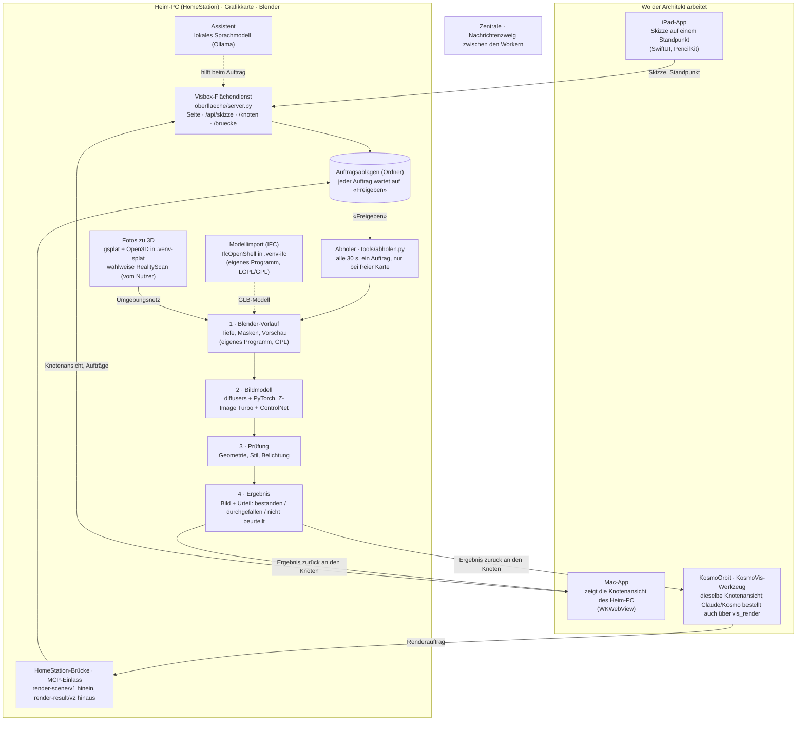

# Werkzeuge und Architektur von Visbox

*Stand: 20.10.2026. Owner-Wunsch vom selben Tag: die Produkte, die Visbox benutzt, mit Logo und
Funktion auf der Kosmo-Tafel, in wenigen Worten erklärt, was jedes beiträgt — und ein Organigramm,
wie alle Programme zusammenhängen.*

Dieses Blatt ist die ausführliche Fassung der Tafelkarten. Massgeblich für jede Lizenz bleibt
`NOTICE`; hier steht nur, was dort (oder in `pyproject.toml`, `kosmovis/package.json`,
`src/aiimaging/backbone.py`, `tiefenschaetzer.py`, `einbetter.py`) belegt ist.

**Tafelkarten** (Zweig `zentrale` im KosmoOrbit-Repo, Texte englisch):

| Gruppe | Datei |
|---|---|
| Visbox · Tools | `tafel/kosmovis/20261020-werkzeuge-00-lizenzen.png` … `-05-kern-dienste-schriften.png` (6 Karten) |
| Visbox · Architecture | `tafel/kosmovis/20261020-architektur-00-uebersicht.png`, `-01-ein-auftrag.png` |

Logos stammen aus **Simple Icons** (Fassung 13.21.0, CC0), abgerufen über jsDelivr; wo es dort
keines gibt, steht eine neutrale **Monogramm-Kachel** mit zwei, drei Buchstaben, keine
nachgezeichnete Marke. Jede Karte trägt die Zeile «Logos: Simple Icons (CC0); trademarks belong to
their owners». Die Bauskripte liegen nicht im Repo (nur im Arbeitsordner der Sitzung).

---

## 1 · Die Werkzeuge

Lizenzklasse: **frei** = MIT, Apache-2.0, BSD, MIT-CMU, OFL (nur Schriften) · **Copyleft** = nur
hinter der Prozessgrenze · **nicht ausgeliefert** = vom Nutzer oder von pip installiert ·
**Lizenz offen** = markiert, nie Vorgabe · **Plattform** = gehört zum Betriebssystem.

### Rendern und KI-Laufzeit

| Werkzeug | Lizenz | Was es zu Visbox beiträgt | Wo |
|---|---|---|---|
| Blender + Cycles | GPL-2.0-or-later (Binärfassungen GPL-3.0-or-later) — **Copyleft** | Rechnet die Grundlage: Tiefe, Masken, Vorschaubild | Heim-PC, Renderkette; nur als `blender --background`, nie `import bpy` |
| PyTorch (torch) | BSD-3-Clause | Rechnet die neuronalen Netze auf der Grafikkarte | Heim-PC, Renderkette und Splat-Brücke |
| diffusers | Apache-2.0 | Lädt und betreibt die Bildmodelle | Heim-PC, Renderkette (Ersatz für ComfyUI, GPL) |
| transformers | Apache-2.0 | Betreibt die Prüfmodelle für Tiefe und Stil | Heim-PC, Bildprüfung |
| NVIDIA-CUDA-Laufzeit | proprietär, von pip mit torch nachgezogen — **nicht ausgeliefert** | Rechenbibliotheken der Grafikkarte, die torch unter Linux braucht | Heim-PC |
| LoRA-Trainer kohya-ss/sd-scripts · ostris/ai-toolkit | Apache-2.0 · MIT | Trainieren kleine Stil-Zusätze zu einem Bildmodell | Heim-PC, eigene Umgebung, als eigenes Programm |

### Bildmodelle und Prüfmodelle (Gewichte nie im Repo)

| Werkzeug | Lizenz | Was es zu Visbox beiträgt | Wo |
|---|---|---|---|
| Z-Image Turbo (Vorgabe) | Apache-2.0 | Vorgabe-Bildmodell: schnell, folgt der Tiefenkarte | Heim-PC, `VORGABE_BACKBONE` |
| ControlNet Union zu Z-Image Turbo | Apache-2.0 | Hält das Bild auf der Geometrie des Modells | Heim-PC, immer mitgeladen |
| Qwen-Image-Edit-2511 · Qwen-Image-2512 | Apache-2.0 | Weitere eingetragene Bildmodelle | Heim-PC, Modellregister |
| FLUX.2 klein 4B | Apache-2.0 | Weiteres kleines Bildmodell | Heim-PC, Modellregister |
| Qwen-Image-2.1 | Qwen Research License — **Lizenz offen** (E128) | Bestellbar, nie Vorgabe; jedes Ergebnis markiert | Heim-PC; vor einer Veröffentlichung lösen oder entfernen |
| SDXL Juggernaut XL v9 · SD 3.5 Large | CreativeML OpenRAIL-M · Stability AI Community License — nutzungsbeschränkt | Eingetragen, mit Nutzungsschranken in der Lizenz | Heim-PC, Modellregister (Schranke «behind paid API services» bei SDXL: Owner-Frage, steht in `backbone.py`) |
| Depth Anything V2 Small | Apache-2.0 | Geometrieprüfung: hält das Bild die Tiefe des Modells? | Heim-PC, nach jedem Bild |
| SigLIP 2 base | Apache-2.0 | Stilprüfung: vergleicht das Aussehen mit Referenzen | Heim-PC (statt DINOv3) |
| ausgeschlossen: FLUX.1-dev · FLUX.2-dev · DINOv3 | nicht-kommerziell bzw. Sonderlizenz | Von der Lizenzregel abgewiesen, auch für LoRAs | nirgends |

### Geometrie, IFC und Fotos zu 3D

| Werkzeug | Lizenz | Was es zu Visbox beiträgt | Wo |
|---|---|---|---|
| IfcOpenShell 0.8.5 | LGPL-3.0-or-later, enthält CGAL-Teile unter GPL-3.0-or-later — **Copyleft** | Liest IFC-Gebäudemodelle als Geometrie | Heim-PC, eigene Umgebung `.venv-ifc`, als eigenes Programm |
| trimesh | MIT | Schreibt das umgewandelte Modell als GLB-Netz | nur `.venv-ifc` |
| shapely (mit GEOS) | BSD-3-Clause, GEOS LGPL-2.1 — **Copyleft-Anteil** | 2D-Geometriebibliothek in der IFC-Umgebung | nur `.venv-ifc`, nie im Kern |
| gsplat 1.5 | Apache-2.0 | Rendert den Splat aus vielen Blickwinkeln | Heim-PC, Splat-Brücke, `.venv-splat` |
| Open3D | MIT | Verschmilzt diese Tiefenbilder zu einem farbigen Netz | Heim-PC, Splat-Brücke, `.venv-splat` |
| COLMAP-Dateiformat | eigener Code (Apache-2.0) | Liest die Kamerastandorte einer Fotoaufnahme | Kern; pycolmap nicht verwendet (bringt GPL-Teile mit) |
| Epic RealityScan 2.x | proprietär — **vom Nutzer installiert, nicht ausgeliefert** | Wahlweise besseres Netz aus Fotos; nie Voraussetzung | nur am Rechner des Lizenznehmers, nie als Dienst über KosmoOrbit |
| Blender (Import) | GPL — **Copyleft** | Lädt GLB und Umgebungsnetz für das Rendern | Heim-PC, dieselbe Prozessgrenze wie beim Rendern |

### Knotenansicht und Apps

| Werkzeug | Lizenz | Was es zu Visbox beiträgt | Wo |
|---|---|---|---|
| React · react-dom | MIT | Zeichnet die Knotenansicht im Browser | Knotenansicht (`kosmovis/`), ausgeliefert |
| zod | MIT | Prüft, ob Auftrag und Ergebnis die vereinbarte Form haben | Knotenansicht, Verträge |
| zustand | MIT | Hält den Zustand der Knotenansicht | Knotenansicht, ausgeliefert |
| TypeScript | Apache-2.0 | Sprache der Knotenansicht, vor jedem Bau geprüft | nur Bau |
| Vite · Vitest | MIT | Baut die Knotenansicht und fährt ihre Proben | nur Bau und Prüfung |
| Swift · SwiftUI | Apple-Plattform | Bildschirme der iPad- und der Mac-App | iPad- und Mac-App |
| PencilKit | Apple-Plattform | Zeichnen mit dem Apple Pencil auf einem Standpunkt | iPad-App |
| WebKit · Network · Security · CryptoKit | Apple-Plattform | Mac zeigt die Knotenansicht des Heim-PC; sicheres Koppeln | Mac-App (WKWebView), iPad-App |
| GitHub Actions · gh | MIT | Baut die Apps auf einem Mac-Rechner von GitHub, legt Freigaben ab | nur Prüfstrecke |

### Python-Kern, Helfer am Heim-PC, Schriften

| Werkzeug | Lizenz | Was es zu Visbox beiträgt | Wo |
|---|---|---|---|
| Python 3.11+ mit Standardbibliothek | Plattform | Die Kernbibliothek, ohne Pflicht-Abhängigkeit | überall (`pip install visbox`, `import aiimaging`) |
| numpy | BSD-3-Clause, Rad trägt libquadmath (LGPL-2.1-or-later) — **offener Punkt** | Rechnet die 16-Bit-Tiefenkarte für das Bildmodell um | nur im Renderschritt |
| Pillow | MIT-CMU | Liest und schreibt die Bilder | Renderkette und Prüfung |
| MCP-SDK (mcp 1.x) | MIT, wahlweise | Lässt den Assistenten von KosmoOrbit Renders bestellen | Heim-PC, MCP-Einlass |
| Ollama · Qwen3 30B/14B · gpt-oss 20B | MIT · Apache-2.0 — **nicht ausgeliefert** | Lokales Sprachmodell für den Visbox-Assistenten | Heim-PC, vom Owner eingerichtet |
| Tailscale | BSD-3-Clause (tailscaled), Koordination proprietär — **nicht ausgeliefert** | Erreicht den Heim-PC von iPad und Mac unterwegs | vom Owner installiert |
| OpenSSL · Avahi · libnotify | Apache-2.0 · LGPL-2.1-or-later · LGPL-2.1-or-later — **Copyleft-Anteil** | Koppeln im Heim-WLAN: Zertifikat, Auffinden, Zahl am Bildschirm | Heim-PC, je als eigenes Programm |
| IBM Plex Sans/Mono · Instrument Serif · Lato · PT Sans Narrow | OFL-1.1 | Schriften der Apps und der Knotenansicht | iPad-, Mac-App, Knotenansicht; unverändert, Lizenz beigelegt |

### Copyleft-Funde und ihre Grenze (ausdrücklich gemeldet)

| Fund | Lizenz | Wie begrenzt |
|---|---|---|
| Blender | GPL-2.0/3.0-or-later | eigenes Programm (`blender --background`), kein `import bpy` |
| IfcOpenShell mit CGAL | LGPL-3.0+ / GPL-3.0+ | eigene Umgebung `.venv-ifc`, Aufruf als eigenes Programm |
| Open CASCADE, GMP, MPFR (im IfcOpenShell-Rad) | LGPL | dieselbe Grenze |
| GEOS (im shapely-Rad) | LGPL-2.1 | nur `.venv-ifc` |
| Avahi, libnotify | LGPL-2.1-or-later | je als eigenes Programm |
| Wine (im Linux-Paket von RealityScan) | LGPL-2.1-or-later | gehört zur Installation des Nutzers, als Programm gestartet |
| libgomp, libgfortran (in torch- und numpy-Rädern) | GPL-3.0+ mit GCC-Ausnahme | die Lizenzausnahme hebt das Copyleft auf |
| **libquadmath (im numpy-Rad)** | LGPL-2.1-or-later | **nicht begrenzt — offener Punkt**: erreicht den Renderprozess; Owner-Entscheid steht aus (`NOTICE`, `AUFLOESUNG: KEINE`) |

**Kein AGPL** im Einsatz. Wegen der Lizenz **nicht verwendet**: ComfyUI (GPL-3.0), OneTrainer und
SimpleTuner (AGPL-3.0), text-generation-webui (AGPL-3.0), pycolmap (bringt SuiteSparse unter
GPL-2.0+ mit), FLUX.1-dev und FLUX.2-dev (nicht-kommerziell), DINOv3 (Sonderlizenz).

---

## 2 · Die Architektur

**Lesehilfe in fünf Sätzen.**

1. **Die Knotenansicht ist die Arbeitsfläche** (Owner-Klarstellung 14.10.2026): in der Mac-App, im
   Browser des Heim-PC oder als KosmoVis-Werkzeug in KosmoOrbit. iPad und Visbox-Seite liefern nur
   zu — die Skizze kommt über den Flächendienst in den Knoten «Sketch from iPad».
2. **Ein Auftrag läuft immer über eine Brücke in eine Ablage**: der eigene Weg `/bruecke` des
   Flächendienstes, die Brücke von KosmoOrbit oder der MCP-Einlass. In der Ablage wartet er auf
   «Freigeben»; ohne diesen Klick wird nichts gerechnet.
3. **Der Abholer** am Heim-PC schaut alle 30 Sekunden nach, nimmt einen freigegebenen Auftrag, aber
   nur bei freier Grafikkarte, und rechnet je Kamera: Blender-Vorlauf → Bildmodell → Prüfung.
4. **Was copyleft ist, läuft als eigenes Programm**: Blender, IfcOpenShell (in `.venv-ifc`). Die
   Splat-Brücke (`.venv-splat`) ist frei lizenziert, steht aber wegen Regel 4 ebenfalls in einem
   eigenen Prozess (torch und CUDA nicht im Kern).
5. **Die Zentrale** ist kein Teil eines Renders, sondern der Briefkasten, über den die Worker
   (Integrator, UI, KosmoVis, HomeStation, LW) Aufträge, Meldungen und Tafelbilder austauschen.

### Der Weg eines Render-Auftrags (Karte `architektur-01-ein-auftrag`)

1. **Ausführen** am Render-Knoten: Szene, Prompt, Zahlen und Kameras werden ein Auftrag.
2. **Brücke**: Der Auftrag geht als `render-scene/v1` in die Ablage.
3. **Freigeben**: erst dieser Klick schickt ihn in die Reihe.
4. **Abholer**: holt ihn innert 30 s, wenn die Grafikkarte frei ist.
5. **Blender-Grundlage**: je Kamera einmal Tiefe, Masken, Vorschau — abgelegt zur Wiederverwendung.
6. **KI-Varianten**: Das Bildmodell malt auf dieser Grundlage, mit festem Startwert und gleicher Pose.
7. **Prüfung**: Geometrie, Stil, Belichtung — bestanden, durchgefallen oder nicht beurteilt.
8. **Zurück am Knoten**: `render-result/v2` mit Bildern, Urteil, Grundlage, Startwert und Pose.

**Eine Grundlage, mehrere Varianten (Owner-Grundsatz Nr. 85):** Der langsame Teil (Blender) läuft
einmal; jede weitere Variante braucht nur das Bildmodell und soll deckungsgleich bleiben.
*Stand 20.10.2026 (Einbau-Stand C66, «halb»):* Heim-PC und Vertrag gebaut, der Knotenteil offen,
die Messung der Deckungsgleichheit am Heim-PC liegt als `auf-20261020-289`.

---

## 3 · Quellen

`NOTICE` · `pyproject.toml` · `kosmovis/package.json` und die Pakete darunter ·
`src/aiimaging/backbone.py`, `tiefenschaetzer.py`, `einbetter.py`, `geometrie_qa.py`,
`stil_qa.py`, `abholer.py` · `oberflaeche/server.py`, `oberflaeche/LIESMICH.md` ·
`tools/abholen.py` · `betrieb/README.md` · `ipad/LIESMICH.md` ·
`docs/LAGEBEURTEILUNG_2026-08-14.md` · `docs/LIZENZPRUEFUNG_BINAER_2026-08-18.md` ·
`docs/EINBAU_STAND.md` (C52, C66) · `docs/PLAN.md` (Nr. 85).
